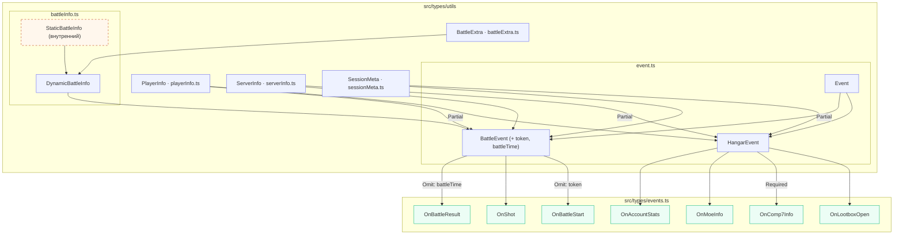

# EventSaver

Принимает события мода wotstat-analytics, проверяет их по JSON-схеме и сохраняет в ClickHouse.

Итоговые события описаны в [events.ts](src/types/events.ts), служебные типы — в [utils](src/types/utils).
На графе типы сгруппированы по файлам; стрелки идут от базового типа к наследнику, `Omit` исключает указанное поле.



Проверки: `bun run typecheck`, `bun run lint`, `bun test`.
Обновление JSON-схемы после изменения типов: `bun run generateJsonSchema`.

## Обновление БД перед выпуском

Вручную выполнить [поля ангарных событий и rank](migrations/20261115_hangar_context_and_comp7_rank.sql), затем [счётчики новых снарядов](migrations/20261115_supported_shells.sql).
Старая версия EventSaver продолжит работать: новые колонки имеют дефолты, существующие колонки (включая `eliteRating`) сохраняются. Скрипты допускают повторное выполнение.

## Продакшен: blue-green деплой

```sh
bash rerun-prod.sh
```

В compose два сервиса: `event-saver-blue` (порт **9100**) и `event-saver-green` (порт **9101**).
Скрипт собирает и запускает неактивный сервис, ждёт успешного healthcheck, затем останавливает и удаляет старый контейнер.
Остановка через SIGTERM даёт приложению завершить запросы и вставки в ClickHouse. Redis при деплое не перезапускается.
Если новая версия не прошла healthcheck, старая продолжает работать.

nginx на хосте должен проксировать `/api` на оба порта:

```nginx
upstream event_saver {
  server 127.0.0.1:9100 max_fails=1 fail_timeout=10s; # blue
  server 127.0.0.1:9101 max_fails=1 fail_timeout=10s; # green
}

# Внутри server { ... }
location /api {
  proxy_pass http://event_saver;
  proxy_next_upstream error timeout non_idempotent;
  proxy_next_upstream_tries 2;
  proxy_connect_timeout 2s;
  proxy_set_header Host $host;
  proxy_set_header X-Real-IP $remote_addr;
  proxy_set_header X-Forwarded-For $proxy_add_x_forwarded_for;
  proxy_set_header X-Forwarded-Proto $scheme;
}
```

`non_idempotent` разрешает nginx повторять POST-запросы на живой контейнер при ошибке соединения.
Откат — повторный деплой предыдущего коммита.
